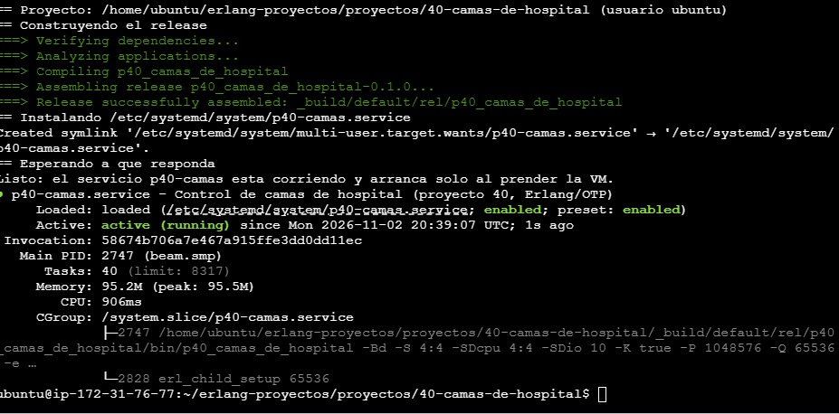
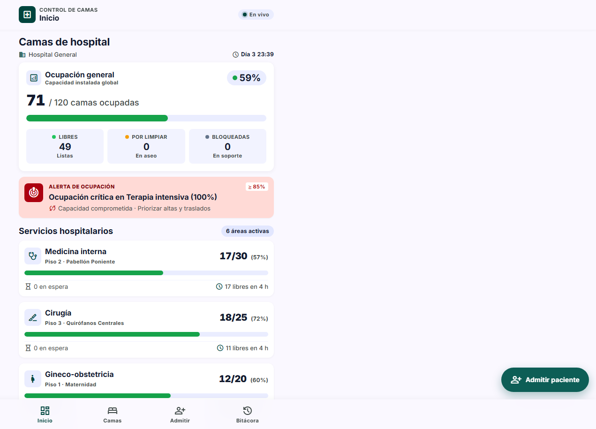
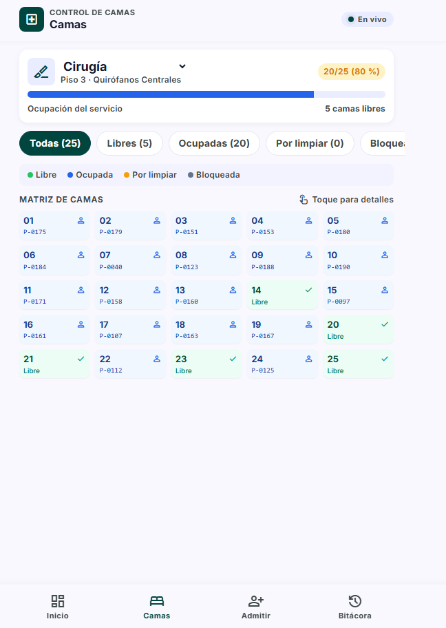
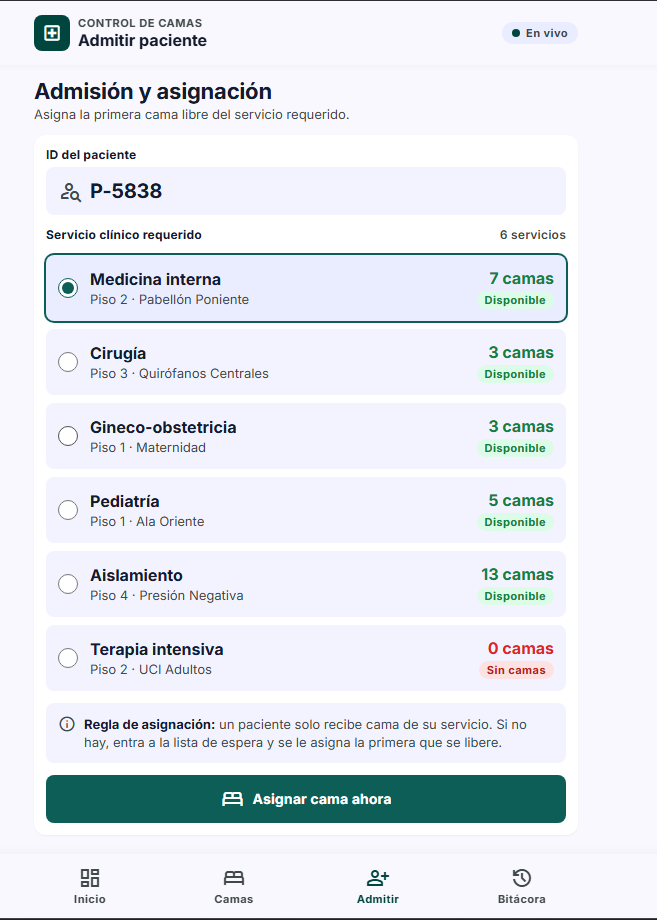
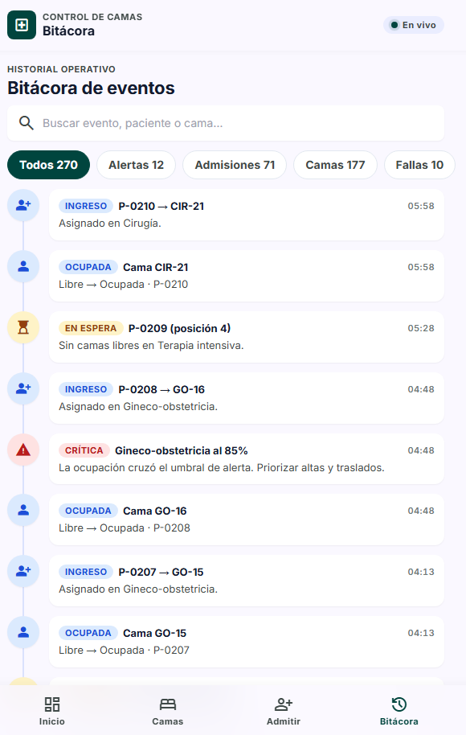
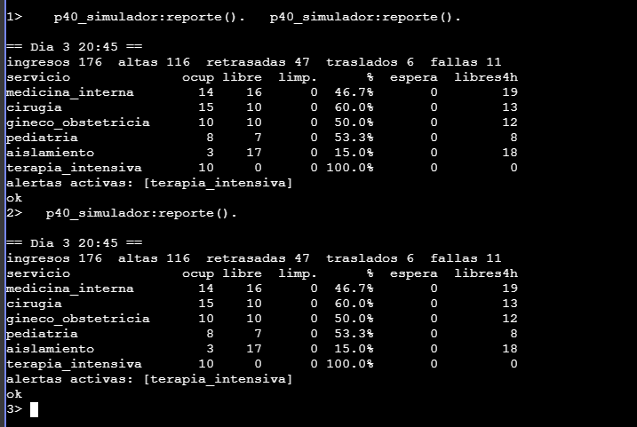

# Manual de uso — Control de Camas de Hospital (Erlang/OTP)

**Proyecto #40 · Programación Lógica y Funcional 2026B · TecNM campus Tijuana**
Autor: Sebastián Martínez García ([@Gamase](https://github.com/Gamase)) ·
Código: [Gamase/erlang-proyectos › proyectos/40-camas-de-hospital](https://github.com/Gamase/erlang-proyectos/tree/main/proyectos/40-camas-de-hospital)

---

## 1. ¿Qué es y para qué sirve?

Es un sistema para controlar las **120 camas de un hospital** repartidas en 6 servicios
(Medicina interna, Cirugía, Gineco-obstetricia, Pediatría, Aislamiento y Terapia intensiva).
El personal de admisión y enfermería lo usa desde el celular para:

- Ver en tiempo real cuántas camas hay **libres, ocupadas, por limpiar o bloqueadas**.
- **Asignar cama** a un paciente que ingresa (solo de su servicio).
- Formar al paciente en **lista de espera** cuando no hay cama, y asignársela sola en cuanto se libera.
- Dar **altas**, controlar la **limpieza** y hacer **traslados** entre servicios.
- Recibir una **alerta** cuando un servicio pasa del **85 % de ocupación** (punto de saturación).
- Ver cuántas camas se esperan libres en las **próximas 4 horas**.

Por dentro, cada cama es un **proceso de Erlang** (`gen_statem`) vigilado por un **supervisor**.
Si el proceso de una cama falla, el supervisor lo reinicia y la cama **recupera su estado**:
el paciente no se pierde. El sistema incluye una **simulación** del hospital que genera
ingresos, altas, traslados y **fallas a propósito** para demostrarlo.

## 2. Requisitos

| Qué | Versión |
|---|---|
| Máquina | Cualquier Linux (probado en una VM **Ubuntu en AWS EC2**) |
| Erlang/OTP | **27** (usa el módulo `json` que trae OTP 27) |
| rebar3 | 3.x |
| git | cualquiera |
| Navegador | Cualquiera moderno (celular o computadora) |

## 3. Instalación

> Todos los comandos se escriben en la terminal de la VM (en EC2: **Connect → EC2 Instance Connect**).

**Paso 1. Verifica Erlang 27**

```bash
erl -noshell -eval 'io:format("~s~n",[erlang:system_info(otp_release)]), halt().'
```

Debe imprimir `27`. Si no tienes Erlang: `sudo apt update && sudo apt install -y erlang` y
vuelve a verificar; si tu distribución instala una versión menor a 27, instala OTP 27 con
[asdf](https://asdf-vm.com/) como indica el `AGENTS.md` del curso.

**Paso 2. Instala rebar3**

```bash
curl -O https://s3.amazonaws.com/rebar3/rebar3
chmod +x rebar3 && sudo mv rebar3 /usr/local/bin/
```

**Paso 3. Descarga el proyecto**

```bash
git clone https://github.com/Gamase/erlang-proyectos.git
cd erlang-proyectos/proyectos/40-camas-de-hospital
```

**Paso 4. Compila y corre las pruebas**

```bash
rebar3 compile
rebar3 eunit
```

Debe terminar con **`20 tests, 0 failures`**. Las pruebas incluyen pruebas de caos (matar
procesos y verificar que se recuperan), la simulación de 2 días y la API web.

**Paso 5. Abre el puerto 8080 (solo en AWS)**

En la consola de EC2: tu instancia → pestaña **Security** → clic en el **Security group** →
**Inbound rules** → **Edit inbound rules** → **Add rule**:

| Type | Port range | Source |
|---|---|---|
| Custom TCP | 8080 | My IP |

Guarda con **Save rules** (no borres la regla de SSH que ya existe).

## 4. Ejecución y acceso

```bash
rebar3 shell
```

Abre en el navegador: **`http://IP-PÚBLICA-DE-TU-EC2:8080`**
(la IP pública aparece en el resumen de tu instancia en EC2). En tu propia computadora sería
`http://localhost:8080`.

El sistema arranca con la **simulación encendida**: 1 minuto del hospital dura 100 ms, así que
**un día simulado dura 2.4 minutos**. Arriba a la derecha verás **"En vivo"** cuando la página
está recibiendo datos en tiempo real.

Para detenerlo: en la terminal escribe `q().` y Enter (o `Ctrl+C` dos veces).

### 4.1 Dejarlo como servicio (arranca solo, sin terminal abierta)

`rebar3 shell` sirve para probar, pero si cierras la terminal la app se apaga. Para dejarla
corriendo siempre, se instala como **servicio de systemd**: arranca sola al prender la VM y,
si la máquina virtual de Erlang llegara a morir completa, systemd la vuelve a levantar.

1. Cierra el `rebar3 shell` si lo tienes abierto (escribe `q().`).
2. Instala el servicio (actualiza el código, construye el *release* y lo activa):

```bash
cd ~/erlang-proyectos/proyectos/40-camas-de-hospital
git pull
bash deploy/instalar-servicio.sh
```

Al final debe decir **"Listo: el servicio p40-camas esta corriendo"**. Ya puedes cerrar la
terminal: la página sigue en `http://IP-PÚBLICA:8080`.



**Comandos para manejar el servicio:**

| Para… | Comando |
|---|---|
| Ver si está corriendo | `systemctl status p40-camas` |
| Ver los logs en vivo | `journalctl -u p40-camas -f` (sal con `Ctrl+C`) |
| Reiniciarlo | `sudo systemctl restart p40-camas` |
| Detenerlo | `sudo systemctl stop p40-camas` |
| Que ya no arranque solo | `sudo systemctl disable --now p40-camas` |
| Actualizar tras un `git pull` | `rebar3 release && sudo systemctl restart p40-camas` |

**Consola del nodo en vivo** (para el reporte, la prueba de caos o diagnóstico con `recon`):

```bash
_build/default/rel/p40_camas_de_hospital/bin/p40_camas_de_hospital remote_console
```

```erlang
p40_simulador:reporte().                 % tabla por servicio
recon:proc_count(memory, 5).             % los 5 procesos que más memoria usan
recon:proc_count(message_queue_len, 5).  % procesos con más mensajes pendientes
exit(whereis('p40_cama_CIR-01'), kill).  % prueba de caos manual: la cama vuelve sola
```

> ⚠️ Para salir de `remote_console` presiona **`Ctrl+C` dos veces**. **No uses `q().`**:
> en la consola remota `q().` apaga el nodo del servicio (systemd lo vuelve a levantar,
> pero se reinicia la simulación).

## 5. Uso, pantalla por pantalla

La app tiene 4 pestañas abajo: **Inicio, Camas, Admitir y Bitácora**.

### 5.1 Inicio — ocupación en vivo



- **Ocupación general:** camas ocupadas de 120, con libres, en limpieza y bloqueadas.
- **Alerta roja:** aparece sola cuando un servicio llega al 85 % o más, y desaparece cuando baja.
- **Servicios:** cada tarjeta muestra ocupadas/total, el color del nivel
  (🟢 menos de 75 %, 🟠 75–84 %, 🔴 85 % o más), pacientes en espera y **camas que se esperan
  libres en 4 h**. Toca una tarjeta para ver sus camas.
- **Simulación del escenario** (hasta abajo): contadores de ingresos, altas, altas retrasadas,
  traslados y fallas, más el botón **Simular brote en aislamiento**.

### 5.2 Camas — matriz y detalle



1. Elige el servicio en el selector de arriba.
2. Filtra con los chips: **Todas, Libres, Ocupadas, Por limpiar, Bloqueadas**.
3. Cada cuadro es una cama: 🔵 ocupada (muestra el paciente), 🟢 libre,
   🟠 por limpiar (muestra los minutos que faltan), ⚪ bloqueada.
4. **Toca una cama** para abrir su detalle. Las acciones cambian según el estado:

| Estado de la cama | Acciones disponibles |
|---|---|
| Ocupada | **Dar de alta** (pasa a limpieza), **Programar alta** (2 h a 48 h), **Trasladar** a otro servicio |
| Por limpiar | **Limpieza terminada** (si no, termina sola al acabar el tiempo de limpieza) |
| Libre | **Bloquear (mantenimiento)** |
| Bloqueada | **Desbloquear** |

Si intentas algo que no aplica (por ejemplo, dar de alta una cama libre), el sistema lo rechaza
con un aviso. Esas reglas viven en la máquina de estados de cada cama.

### 5.3 Admitir paciente



1. Escribe el **ID del paciente** (viene uno sugerido, por ejemplo `P-5838`).
2. Elige el **servicio**. Junto a cada uno ves cuántas camas libres tiene.
3. Toca **Asignar cama ahora**. Hay dos resultados posibles:
   - ✅ **Cama asignada:** te dice qué cama le tocó (por ejemplo `MI-14`). Con **Ver en matriz**
     vas directo a esa cama.
   - ⏳ **Lista de espera:** si el servicio no tiene camas libres, el paciente queda formado y
     ves su posición. **Nunca se le asigna cama de otro servicio**: un paciente de terapia
     intensiva no puede ir a una cama general. Cuando se libere una cama de su servicio, se le
     asigna automáticamente.

### 5.4 Bitácora — eventos en tiempo real



Todo lo que pasa en el hospital aparece aquí en cuanto ocurre, sin recargar la página:
ingresos, cambios de estado de las camas, pacientes en espera, traslados, alertas y brotes.

- Filtra con los chips: **Todos, Alertas, Admisiones, Camas, Fallas**.
- Busca por paciente, cama o servicio en la barra de búsqueda.
- En **Fallas** verás pares de eventos ⚡ **Falla** ("proceso de PED-04 terminado") y
  🔄 **Recuperada** ("PED-04 volvió en ocupada"). Ahí se ve en vivo cómo el supervisor de OTP
  reinicia la cama sin perder al paciente.

## 6. Ejemplos de uso

**Ejemplo 1 — Ingreso normal.** Admitir → `P-1001` → Cirugía → Asignar. Resultado: "Cama
asignada: CIR-xx". En Inicio, Cirugía sube una cama ocupada.

**Ejemplo 2 — No hay cama.** Admitir → Terapia intensiva cuando dice **0 camas** → Asignar.
Resultado: "Lista de espera, posición N". Ve a Camas → Terapia intensiva, abre una cama ocupada y
**Dar de alta**. Cuando termine la limpieza, el primer paciente de la fila recibe esa cama solo
(en la bitácora sale como **Desde espera**).

**Ejemplo 3 — Alta y limpieza.** Camas → cualquier cama ocupada → **Dar de alta**. La cama se
pone 🟠 con los minutos de limpieza; al terminar vuelve a 🟢 libre.

**Ejemplo 4 — Traslado.** Camas → cama ocupada de Medicina interna → elige "Terapia intensiva" en
el selector → **Trasladar**. El paciente pasa a una cama de UCI y la de origen queda en limpieza.
Si UCI no tiene cama, el paciente se queda donde está.

**Ejemplo 5 — Brote.** Inicio → **Simular brote en aislamiento**. Entran 25 pacientes de golpe:
Aislamiento se llena, sale la alerta roja y los que no alcanzan cama quedan en espera.

**Ejemplo 6 — Desde la consola** (la terminal donde corre `rebar3 shell`):

```erlang
p40_simulador:reporte().          % tabla por servicio (ver captura abajo)
p40_simulador:brote(25).          % mismo brote que el botón
p40_admisiones:en_espera().       % quién espera cama
p40_simulador:pausar().           % congela la simulación (reanudar() para seguir)
```



**Ejemplo 7 — Desde la API** (otra terminal en la VM):

```bash
curl localhost:8080/api/resumen
curl -X POST localhost:8080/api/admisiones -d '{"paciente":"P-2001","servicio":"pediatria"}'
curl -X POST localhost:8080/api/camas/PED-01/alta   # si no esta ocupada responde 409
curl -N localhost:8080/sse        # eventos en vivo (Ctrl+C para salir)
curl localhost:8080/metrics       # métricas en formato Prometheus
```

## 7. Configuración

Todo se ajusta en `config/sys.config` (reinicia `rebar3 shell` después de cambiarlo):

| Parámetro | Valor por defecto | Para qué |
|---|---|---|
| `puerto` | `8080` | Puerto de la página y la API |
| `simulacion` | `true` | `false` para usarlo sin pacientes simulados |
| `minuto_ms` | `100` | Milisegundos reales por minuto del hospital (`60000` = tiempo real) |
| `limpieza_min` | `45` | Minutos que tarda una limpieza normal |
| `umbral_alerta` | `0.85` | Ocupación que dispara la alerta |
| `falla_cada_min` | `360` | Cada cuántos minutos simulados se mata una cama al azar (`0` = nunca) |

## 8. Solución de problemas comunes

| Problema | Causa probable | Solución |
|---|---|---|
| El navegador no abre `http://IP:8080` (se queda cargando) | Falta la regla del puerto 8080, o tu IP cambió desde que la creaste ("My IP") | Revisa el paso 5. Si cambiaste de red (casa/escuela), edita la regla y vuelve a elegir **My IP** |
| Funcionaba y después de prender la instancia ya no abre | En EC2 la **IP pública cambia** cada vez que detienes y arrancas la instancia | Copia la IP nueva del resumen de la instancia (si instalaste el servicio, la app ya arrancó sola) |
| El lab de AWS Academy expiró | Las sesiones del lab se apagan y a veces se reinicia el entorno | Vuelve a iniciar el lab; si la instancia se borró, repite la sección 3 |
| `undef` con `json:encode` al arrancar | Estás usando Erlang menor a 27 | Verifica con el paso 1 e instala OTP 27 |
| `eaddrinuse` al arrancar | Ya hay algo usando el puerto 8080: otro `rebar3 shell` o el servicio | Cierra el shell (`q().`) o detén el servicio: `sudo systemctl stop p40-camas` |
| El servicio no arranca | Error al construir el release o puerto ocupado | `journalctl -u p40-camas -n 50` muestra el motivo |
| `Failed to update package cowboy from repo hexpm` | La VM no tiene internet hacia hex.pm | Revisa la salida a internet de la VM y vuelve a correr `rebar3 compile` |
| Arriba dice **"Reconectando…"** | Se cortó la conexión en vivo (red o servidor detenido) | La página se reconecta sola; si no, revisa que `rebar3 shell` siga corriendo y recarga |
| Los números no se mueven | La simulación está en pausa o apagada | En la consola: `p40_simulador:reanudar().` y revisa `simulacion` en `sys.config` |
| Ves `SUPERVISOR REPORT ... reason: killed` en la consola | **Es normal**: son las fallas que la simulación inyecta a propósito | Nada. Es la prueba de que OTP reinicia las camas |

## 9. ¿Cómo está hecho? (resumen técnico)

```
p40_camas_de_hospital_sup (rest_for_one)
|- p40_store        estado de camas y lista de espera (ETS), para sobrevivir a fallas
|- p40_eventos      bitácora y alertas del 85 %
|- p40_camas_sup    -> un supervisor por servicio -> un gen_statem por cama (120)
|- p40_admisiones   asigna camas (un solo proceso: dos peticiones por la última cama, solo una gana)
|- p40_simulador    genera el escenario y mata camas al azar
`- p40_http         cowboy: página, API REST, eventos en vivo (SSE) y /metrics
```

- **Interfaz** diseñada en Google Stitch y conectada al backend con HTML/CSS/JS plano.
- **Pruebas:** 20 tests con eunit, incluidas pruebas de caos.
- El diseño completo, las pruebas de caos y el bug que encontró la simulación están en el
  [README del proyecto](https://github.com/Gamase/erlang-proyectos/tree/main/proyectos/40-camas-de-hospital).

*Proyecto educativo de simulación: los pacientes son IDs ficticios y no hay datos personales.*
